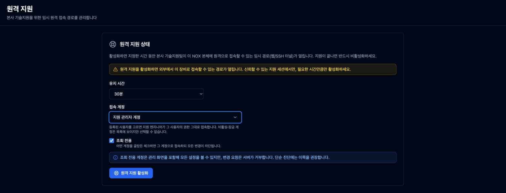
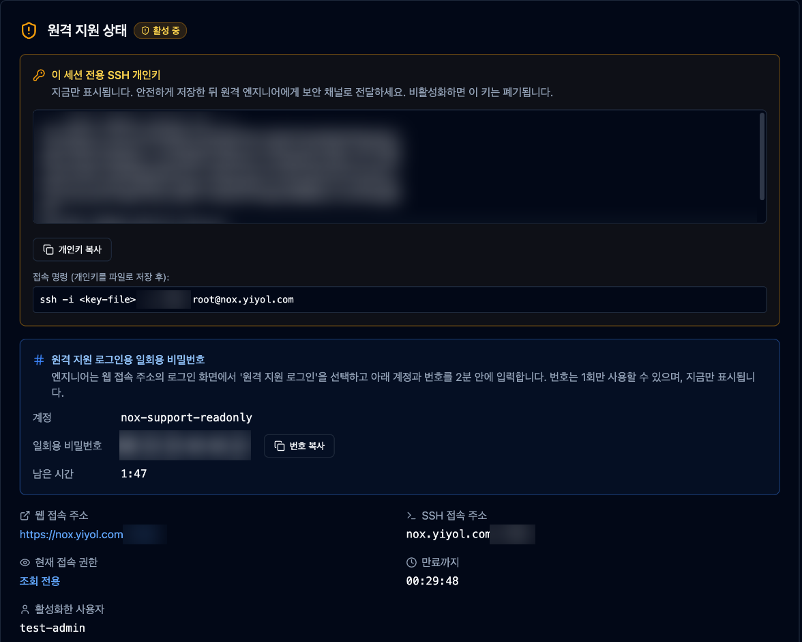
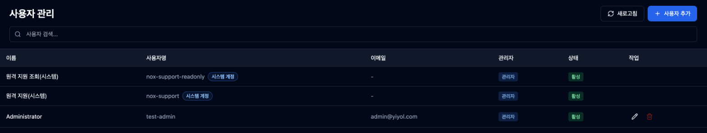
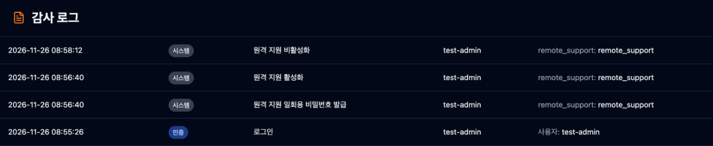

# 관리자 비밀번호를 넘기지 않는 원격 지원 — NOX 원격 지원 기능 정리

현장 NVR에 문제가 생기면 설치업체나 제조사 기술지원팀이 장비를 직접 봐야 할 때가 많습니다. 그런데 원격으로 들어가는 방법을 정하는 순간부터 고민이 시작됩니다. 공유기에 포트를 열어 두면 지원이 끝난 뒤에도 그 경로가 남기 쉽고, 관리자 계정의 비밀번호를 전화나 메신저로 알려 주면 그 비밀번호를 언제 바꿔야 할지 아무도 챙기지 않습니다. 원격 데스크톱 프로그램을 따로 설치하는 방식은 장비에 관리할 소프트웨어가 하나 더 늘어납니다.

NOX의 원격 지원은 이 문제를 장비 안에서 해결합니다. 관리자가 버튼을 눌러 켠 동안에만 접속 경로가 열리고, 정한 시간이 지나면 저절로 닫힙니다. 엔지니어는 관리자 비밀번호 대신 2분 동안만 유효한 일회용 비밀번호로 들어오며, 필요하면 아무것도 바꿀 수 없는 조회 전용으로만 들어오게 할 수 있습니다. 누가 언제 경로를 열고 닫았는지는 감사 로그에 남습니다.

이 글은 테스트 장비에서 원격 지원을 직접 켜고 끄면서 찍은 화면을 따라 순서대로 설명합니다.

## 켤 때만 열리고, 시간이 지나면 닫힌다

원격 지원은 **설정 → 시스템 → 원격 지원** 메뉴에 있습니다. 관리자 계정으로, 관리 접속으로 로그인했을 때만 보이는 메뉴입니다.

켜기 전에 정하는 것은 세 가지입니다.

- **유지 시간**: 30분, 1시간, 2시간, 4시간 중에서 고릅니다. 이 시간이 지나면 경로가 자동으로 닫힙니다. 지원이 끝났는데 끄는 것을 잊어도 경로가 계속 열려 있지 않습니다.
- **접속 계정**: 기본값은 원격 지원 전용 계정입니다. 장비에 등록된 특정 사용자를 고르면 엔지니어가 그 사용자의 권한 그대로 들어와, 그 사용자가 실제로 보는 화면과 메뉴에서 문제를 재현할 수 있습니다.
- **조회 전용**: 체크하면 어떤 계정을 골랐든 모든 변경이 막힙니다. 원인을 살펴보는 것이 목적이라면 체크해 두는 것을 권합니다.

**원격 지원 활성화**를 누르면 외부 접속 경로가 열린다는 확인 창이 한 번 더 뜨고, 확인하면 경로가 열립니다.

연결 방식도 짚어 두겠습니다. 원격 지원을 켜면 장비가 본사 중계 서버(`nox.yiyol.com`) 쪽으로 **바깥으로 나가는 연결**을 만들고, 엔지니어는 그 중계 서버를 거쳐 장비에 들어옵니다. 장비 쪽에서 먼저 연결을 만들기 때문에 현장 공유기에 포트를 열거나 고정 IP를 받을 필요가 없습니다. 장비가 인터넷에 연결되어 있으면 별도 설정 없이 바로 동작합니다.

## 비밀번호 대신 2분짜리 일회용 번호

경로가 열리면 카드에 엔지니어에게 넘길 정보가 표시됩니다.

- **웹 접속 주소**: 엔지니어가 장비의 관리 화면에 들어올 주소입니다. 장비에 원래 적용된 HTTPS와 로그인 절차가 그대로 적용됩니다.
- **일회용 비밀번호**: 6자리 숫자입니다. 발급 후 **2분** 안에 써야 하고, **한 번** 로그인하면 사라집니다. 다섯 번 틀리면 폐기되어 다시 발급해야 합니다.
- **현재 접속 권한과 만료까지 남은 시간**: 지금 어떤 권한으로 열려 있는지, 언제 닫히는지 보여 줍니다.
- **세션 전용 SSH 개인키**: 화면 너머의 문제를 봐야 할 때 쓰는 SSH 접속용 키입니다. 장비가 원격 지원을 켤 때마다 새로 만들고, **이 화면에서 한 번만** 보여 줍니다. 서버에 저장하지 않으므로 다시 볼 수 없고, 원격 지원을 끄면 폐기됩니다.

엔지니어는 웹 접속 주소를 열고 로그인 화면에서 **OTP 로그인**을 고른 뒤 전달받은 번호만 입력합니다. 사용자 이름을 따로 넣을 필요가 없습니다. 번호를 보고 서버가 어느 계정으로 들어올지 판단합니다. 2분 안에 로그인하지 못했다면 **일회용 비밀번호 재발급** 버튼으로 새 번호를 받으면 되고, 이때 이전 번호는 바로 무효가 됩니다.

여기서 핵심은 **고객 관리자의 비밀번호가 장비 밖으로 나가지 않는다**는 점입니다. 엔지니어에게 넘어가는 것은 2분 뒤면 쓸 수 없는 번호뿐입니다.

## 엔지니어 전용 계정은 따로 있다

원격 지원 전용 계정을 고르면 엔지니어는 장비에 내장된 시스템 계정으로 로그인합니다. 사용자 관리 화면에서 보면 이 계정들이 일반 사용자와 구분되어 있습니다.

- `nox-support`: 설정 변경까지 할 수 있는 원격 지원 계정입니다.
- `nox-support-readonly`: 조회 전용으로 켰을 때 쓰이는 계정입니다.

두 계정에는 일반 비밀번호가 없어서 일회용 번호로만 로그인할 수 있습니다. 화면에서 보듯 수정·삭제 버튼도 없습니다. 이름을 바꾸거나 비밀번호를 정하거나 역할을 바꾸는 요청은 모두 거부됩니다. 엔지니어가 한 일은 이 계정 이름으로 기록되므로, 나중에 감사 로그에서 장비 관리자가 한 일과 엔지니어가 한 일을 구분할 수 있습니다.

등록된 사용자를 골라 들어온 경우에는 그 사용자의 이름으로 기록되지만, 기록마다 원격 지원으로 들어온 세션이었다는 표시가 함께 남습니다.

## 조회 전용으로 열면 무엇이 달라지나

원격 지원을 요청하는 상황의 대부분은 "왜 이 카메라 녹화가 끊기는지 봐 달라"처럼 원인을 찾는 일입니다. 이럴 때는 조회 전용이 가장 안전합니다.

| 구분 | 조회 전용 세션에서 |
| --- | --- |
| 볼 수 있는 것 | 라이브, 녹화, 검색, 이벤트, 그리고 설정·사용자·네트워크·저장소·로그·업데이트 상태 등 관리 화면 전부 |
| 할 수 없는 것 | 카메라 추가, 설정 저장, 사용자 생성, 저장소 조작, 파일 업로드, 레이아웃 저장 등 모든 변경 |
| 따로 막는 것 | AI 검색 실행. 조회처럼 보이지만 GPU와 저장소를 쓰는 작업이라 막고, 이미 만들어진 결과를 보는 것은 됩니다 |

조회 전용이라고 볼 수 있는 화면이 줄어들지는 않습니다. 진단에 필요한 정보는 관리자와 똑같이 보고, **바꾸는 요청만** 서버가 거부합니다. 이 차단은 특정 화면이 아니라 서버의 인증 단계에서 일괄 적용되므로 어느 화면이나 API 하나가 빠져 있어서 변경이 새어 나가는 일이 없습니다.

조회 전용을 끄고 열어도 몇 가지는 원격으로 할 수 없습니다. 녹화 영상이 남아 있는 카메라나 녹화의 영구 삭제, 카메라 장치 교체, 장비 전원 끄기는 원격 지원 세션에서 거부됩니다. 되돌릴 수 없는 작업은 현장의 관리자가 직접 하도록 남겨 둔 것입니다.

## 누가 언제 열고 닫았는지 남는다

원격 지원을 켜고 끈 기록은 감사 로그에 남습니다. 아래는 테스트 장비에서 원격 지원을 켜고, 캡처를 마친 뒤 끈 기록입니다.

활성화, 일회용 비밀번호 발급, 비활성화가 각각 시각과 실행한 관리자 이름과 함께 기록되어 있습니다. 유지 시간이 다 되어 자동으로 닫힌 경우와 재부팅으로 정리된 경우도 같은 방식으로 남습니다. 엔지니어의 로그인과 로그인 실패는 원격 지원 계정 이름으로 따로 기록됩니다.

고객사의 보안 담당자가 "외부 업체가 우리 장비에 언제 들어왔느냐"고 물으면 이 기록을 보여 주면 됩니다.

## 끝나면 바로 닫힌다

원격 지원이 닫히는 경우는 세 가지입니다.

1. **관리자가 직접 끔**: 카드의 **비활성화** 버튼을 누르면 경로가 바로 닫힙니다.
2. **유지 시간 만료**: 정한 시간이 지나면 장비가 스스로 경로를 닫습니다.
3. **재부팅**: 장비를 다시 켜면 원격 지원 경로는 다시 열리지 않습니다.

어느 경우든 경로가 닫히면 발급된 일회용 번호와 SSH 키가 폐기되고, 들어와 있던 엔지니어의 세션도 함께 끝납니다. 이때 끝나는 것은 엔지니어의 세션뿐입니다. 현장에서 같은 화면을 보던 관리자나 다른 사용자의 화면은 끊기지 않습니다.

관리자와 엔지니어가 같은 화면을 보며 함께 작업하는 상황도 고려되어 있습니다. 엔지니어가 들어와도 원격 지원을 켠 관리자의 세션이 끊기지 않고, 엔지니어의 화면 위쪽에는 원격 지원 세션이라는 안내 띠가 계속 떠 있어 지금 어떤 권한으로, 얼마나 남았는지를 양쪽이 같이 볼 수 있습니다.

## 쓸 수 없는 경우

도입 전에 확인해야 할 조건입니다.

- **NIS 보안 모드에서는 쓸 수 없습니다.** 외부 중계 서버로 나가는 연결 자체가 정책상 허용되지 않기 때문에 메뉴가 나타나지 않습니다. 공공기관 현장이라면 이 점을 먼저 확인해야 합니다.
- **라이선스가 등록되지 않았거나 만료된 장비(Free 모드)에서는 새로 켤 수 없습니다.** 다만 이미 켜져 있던 원격 지원을 **끄는 것은 언제나 가능합니다.** 켜진 채로 라이선스가 만료되어 열린 경로를 닫지 못하는 일이 없도록 한 것입니다.
- **장비가 인터넷에 연결되어 있어야 합니다.** 장비가 본사 중계 서버로 나가는 연결을 만들 수 있어야 합니다. 원격으로 들어갈 수 없는 상황이라면 장비 앞 화면(로컬 콘솔)이 대안입니다.

## 고객에게는 이렇게 설명하세요

설치업체가 유지보수 계약을 제안할 때, 최종 발주처가 원격 지원에서 걱정하는 것은 대개 "외부에서 우리 장비에 마음대로 들어올 수 있느냐"입니다. 이렇게 설명할 수 있습니다.

> "원격 지원은 귀사 관리자가 직접 켤 때만 열리고, 정한 시간이 지나면 자동으로 닫힙니다. 저희는 관리자 비밀번호를 받지 않고, 2분 동안만 쓸 수 있는 일회용 번호로 들어갑니다. 점검만 할 때는 조회 전용으로 열어 설정을 바꿀 수 없게 할 수 있고, 언제 열고 닫았는지는 장비의 감사 로그에 남습니다."

## 마치며

원격 지원에서 위험한 것은 접속 자체보다 **지원이 끝난 뒤에 남는 것들**입니다. 열어 둔 포트, 알려 준 비밀번호, 설치해 둔 원격 프로그램이 그렇습니다. NOX의 원격 지원은 켤 때만 경로를 열고, 비밀번호 대신 일회용 번호를 쓰고, 끝나면 키와 세션을 함께 폐기해서 지원이 끝난 뒤에 남는 것을 감사 기록 하나로 줄였습니다.

현장 구성에서 원격 지원을 어떻게 운영하면 좋을지, NIS 보안 모드 현장에서는 어떻게 지원받을 수 있는지 궁금하시면 **[설치 파트너 상담 신청](/contact/)**을 해 주십시오.

*원격 지원은 라이선스가 등록된 장비에서 쓸 수 있으며, NIS 보안 모드에서는 제공되지 않습니다. 장비가 인터넷에 연결되어 있어야 합니다.*

---

## 관련 글

- [NVR/VMS 국정원 보안요구사항 V3.0 인증 가이드: 영상보안 제품의 보안적합성 검증 전략](/blog/nis-security-requirements-v3-guide.html)
- [유지보수 점검, 말로 묻고 기록으로 남기는 법 — NOX MCP로 녹화 누락·디스크·오프라인 카메라 확인하기](/blog/mcp-maintenance-check.html)
